# Clips — design system e identidade visual

> Engenharia reversa de https://plastic.audio/clips em 28/11/2026. Medido no navegador (desktop 1440×900 e mobile 390×844) e lido no código da captura. O que é interpretação está marcado como tal.
> Estudo de um site de terceiros: logo, textos, vídeos e fotos são da Plastic e ficam em `assets/` só como referência visual.

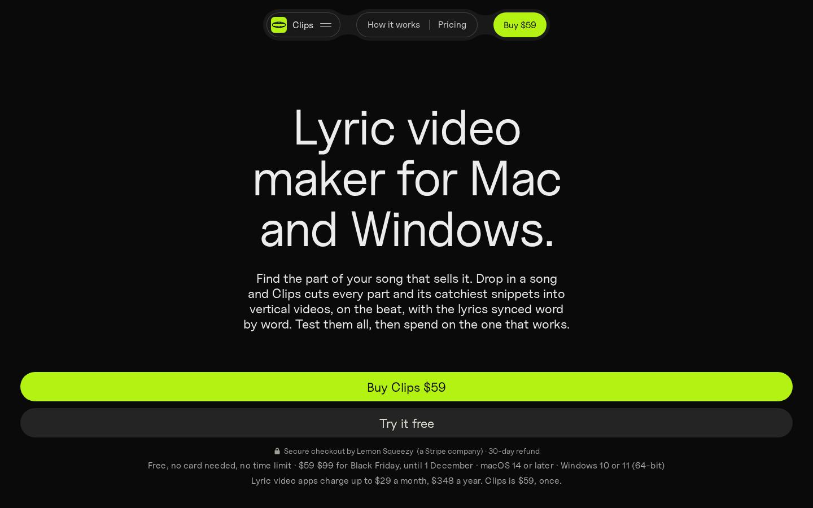

## 0. Ficha

| item | valor |
|---|---|
| Produto | Clips (Plastic): app de Mac e Windows que corta uma música em vídeos verticais com letra, no ritmo |
| Stack | HTML e CSS escritos à mão (882 regras, 106 `@keyframes`) + JS próprio; nenhuma biblioteca de animação; **CSS scroll-driven animations** no hero |
| Fonte | Uncut Sans 400 em toda a interface; Anton e Arimo 700 só dentro dos vídeos de demonstração |
| Paleta-chave | `#0A0A0A` fundo · `#EDEDED` texto · `#A8A8A8` apoio · `#B4F213` acento (volt) · `#F0F0EE` papel |
| Raio | 999px nos botões · 24px nos painéis · 16px nos clipes · 22px na barra |
| Motion em uma linha | Interfaces falsas em CSS que rodam em loop no tempo da música (484 ms = 1 batida a 124 BPM) + uma revelação do app ligada à rolagem |
| Temas | escuro; a seção de preço inverte para papel (`.paper`) |
| Breakpoints | 600px (o grande salto, 104 regras) · 900px · 1100px · 389px · 880px |
| Página | 13.452 px no desktop (14,9 telas), rolagem nativa, sem intro |

## 1. Marca

**Essência (interpretação).** Clips vende teste no lugar de aposta: corta a música inteira em vídeos para o artista rodar todos como anúncio e pagar só no que funcionou. O visual é de ferramenta séria, escura como um editor de vídeo, e a página prova cada promessa com o app funcionando em miniatura.

**Personalidade (interpretação ← evidência)**
- Ferramenta, não festa ← fundo `#0A0A0A`, uma fonte num peso só, ícones de traço de 11–18 px.
- Confiante e direto ← títulos de 72–144 px que terminam com ponto final.
- Musical ← toda demonstração pulsa a 484 ms; letras em Anton amarelo cortadas na batida.
- Honesto com números ← tabela que compara o preço por ano com concorrentes nominais; o preço aparece em cada CTA.

**Logo.** Quadrado verde-volt `#B4F213` com raio de 22,45% (`rx 224.5` em 1000) e, dentro, um disco em perspectiva desenhado com traço preto de 40/1000 (`assets/logo.svg`). Na barra aparece com 28px ao lado da palavra "Clips" em Uncut Sans 16px. Não há versão monocromática no site.

**Voz e texto (regras + exemplos reais)**
- Duas frases curtas em vez de uma longa: "Song in, ads out." · "Test first. Then spend." · "Stop cutting. Start testing."
- O problema contado como cena: "Making 15 videos takes all evening. So you cut two and pray."
- Números no lugar de adjetivos: "66 color presets. 54 effects." · "$59, paid once".
- A objeção respondida antes de aparecer: "Is my unreleased song uploaded anywhere? No. Clips works offline…"
- Sem exclamação, sem "revolucione". Inglês simples, verbos no imperativo.

**O que a marca não é:** colorida na interface (a cor está nos vídeos), negrito (tudo é 400), gradiente decorativo (o único é o céu da cena noturna), animação sem tempo musical.

## 2. Cor

| token | valor | nome no site | onde é usado |
|---|---|---|---|
| `bg` | `#0A0A0A` | `--bg` | página, texto do botão volt, `theme-color` |
| `surface-1` | `#1E1E1E` | `--surface` | painéis de demonstração (`.fvis`) |
| `surface-2` | `#272727` | `--surface-2` | fundo dos clipes 9:16 |
| `surface-3` | `#141414` | — | janela do app |
| `surface-btn` | `#242424` → hover `#2E2E2E` | — | botão "Try it free" |
| `text` | `#EDEDED` | `--ink` | títulos e texto principal (16,9:1) |
| `text-soft` | `#CFCFCF` → hover `#FFFFFF` | — | links da barra |
| `text-muted` | `#A8A8A8` | `--ink-2` | apoio, legendas, rodapé (8,3:1) |
| `line` | `rgba(237,237,237,.2)` | `--line` | contornos de chip, pílula, slot |
| `line-2` | `rgba(237,237,237,.1)` | `--line-2` | divisórias de seção e de FAQ |
| `accent` | `#B4F213` → hover `#C6F84A` | `--volt` | comprar, ícone, ponto de batida, playhead (14,8:1 com `#0A0A0A`) |
| `lavender` | `#CB98F5` | `--lavender` | foco da barra, palavra cantada, linha vencedora |
| `paper` | `#F0F0EE` | `--paper` | seção de preço invertida |
| `lyric` | `#F5EE00` | — | letra dentro dos vídeos (conteúdo, não interface) |
| `signal` | `#F2592E` | — | recorte laranja na waveform |
| `scene` | `#3B3355` | — | espera da paisagem de lavanda |

**Proporção de uso (área medida):** superfícies escuras (`#0A0A0A`, `#141414`, `#1E1E1E`, `#272727`) ocupam quase tudo; o verde-volt soma 154 mil px² (os botões de compra), cerca de 1% da área. O papel `#F0F0EE` aparece uma vez, na seção de preço.

**Regras:** o acento é só para dinheiro (comprar) e para o pulso do produto (batida, playhead). Hierarquia de texto em duas cores: `#EDEDED` diz, `#A8A8A8` explica. Na seção clara, tudo inverte e o botão vira `rgba(10,10,10,.08)` com texto `#0A0A0A`.

## 3. Tipografia

**Uncut Sans 400**, arquivo próprio (`uncut-sans-regular.woff2`, `display: swap`). Um peso só em toda a interface. **Anton 400** e **Arimo 700** vêm do Google Fonts e só aparecem dentro dos vídeos de demonstração. Archivo Black e IBM Plex Mono são carregadas e nenhum texto as usa: custo sem uso. Substituta aberta para estudo: Hanken Grotesk (o preview usa ela; a licença da Uncut Sans não foi conferida).

| papel | CSS do autor | em 1440 | mobile | entrelinha | tracking |
|---|---|---|---|---|---|
| poster (preço) | `clamp(56px, 10vw, 144px)` | 144px | 56px | 1.02 | -0.02em |
| display (h1) | `88px` | 88px | 44px | 1.02 | -0.02em |
| statement (h2) | `72px` | 72px | 34px | 1.02 | -0.02em |
| feature | `clamp(40px, 3.125vw, 45px)` | 45px | 28px | 0.95 | -0.015em |
| quote | `calc(var(--u)*40/18)` | 40px | 28px | 1.2 | -0.015em |
| lede | `calc(var(--u)*1.25)` | 22,5px | 20px | 1.2 | 0 |
| title | `clamp(22px, 1.8vw, 26px)` | 26px | 22px | 1.15 | 0 |
| body | `var(--u)` = `clamp(15px, 1.25vw, 18px)` | 18px | 16px | 1.3 | 0 |
| small | `calc(var(--u)*.875)` | 15,75px | 14px | 1.2857 | 0.01em |
| nav | `16px` | 16px | 16px | 19px | 0 |
| lyric (Anton) | `47.11cqw` do clipe, por palavra | — | — | 1.09 | 0, caixa alta |
| hook (Arimo 700) | `4.89cqw` do clipe | — | — | 1.2 | 0.02em, caixa alta |

Os tamanhos de 88px e 72px são valores fixos que vencem um `clamp(40px, 5.625vw, 81px)` declarado antes: o CSS tem as duas regras, a medição mostra a fixa (medido vence lido). Para reconstruir, uma interpolação razoável é `clamp(2.75rem, 1.73rem + 4.19vw, 5.5rem)` para o h1 e `clamp(2.125rem, 1.24rem + 3.62vw, 4.5rem)` para o h2 (sugestão minha).

**Detalhes:** `text-wrap: balance` em títulos e lede, `text-wrap: pretty` em parágrafos; títulos de seção com `max-width: 11em`; letra dos vídeos com tamanho por palavra (palavra curta fica maior), em `cqw` para escalar com o clipe.

## 4. Layout

- **Unidade:** `--u: clamp(15px, 1.25vw, 18px)` (16px no mobile). Texto e espaço são múltiplos dela.
- **Escala de espaço do autor:** `tie` 9 · `pair` 18 · `gs` 27 · `row` 36 · `group` 54 · `section` 72 · `s96` 108 · `s128` 144 · `gutter` 36 (px em 1440). No mobile a escala é fixa: 8 · 16 · 16 · 24 · 32 · 48 · 64 · 64 · 24.
- **Margem:** `--side: max(36px, calc((100% - 1440px)/2 + 36px))`. Conteúdo até 1368px, alinhado à esquerda; só o hero e o CTA final são centralizados.
- **Ritmo:** cada `section` tem 108px em cima e embaixo, separadas por uma linha de 1px a 10%. Algumas têm altura de uma tela (`.screen`, 900px).
- **Grids:** 4 colunas com gap de 18px (benefícios), 2 colunas com gap de 72/18px (passos), 3 colunas (preço, dias), FAQ em 2 colunas (pergunta e resposta lado a lado).

**Mapa da página**

| bloco | topo | altura | o que é |
|---|---|---|---|
| hero `.lsec` | 0 | 2860 | título, lede, dois CTAs, depois a janela do app sobre a lavanda (presa à rolagem) |
| problema `.screen` | 2860 | 985 | "Making 15 videos takes all evening." + relógio da noite |
| como funciona `#how` | 3845 | 1585 | "Song in, ads out." + quatro passos com demonstrações |
| teste | 5431 | 902 | "Test first. Then spend." + dia 1, dia 1–7, dia 7 |
| efeitos | 6333 | 1992 | "66 color presets. 54 effects." + seletor de efeito ao vivo |
| vídeo próprio | 8325 | 978 | "…lining it up." + backdrops e clipe sincronizado |
| depoimento `.maker` | 9303 | 385 | citação do criador |
| comparação | 9688 | 708 | tabela Clips × editor × concorrentes |
| preço `.paper` | 10396 | 1172 | "$59, paid once" + três planos, fundo claro |
| FAQ `#questions` | 11568 | 1157 | perguntas e respostas em duas colunas |
| fim | 12725 | 727 | "Stop cutting. Start testing." + CTA |

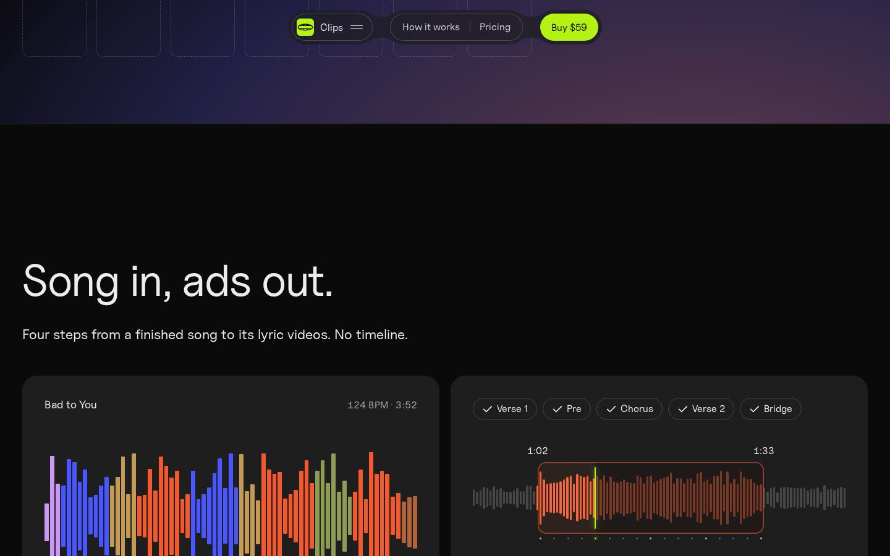

**Breakpoints:** 600px é o salto principal (104 regras: `--u` fixo, uma coluna, barra reduzida a duas pílulas); 900px reorganiza os grids de 4 e 3 colunas; 1100px ajusta painéis.

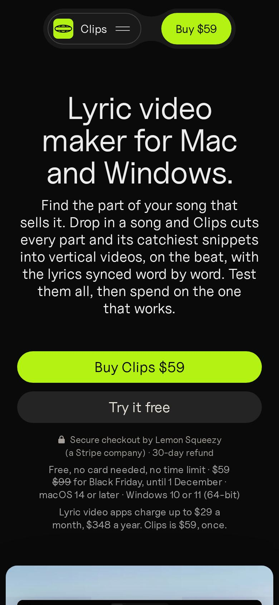

## 5. Forma e profundidade

- **Raios:** 999px (botão, chip) · 24px (painel, plano, menu) · 22px (pílula da barra) · 16px (clipe) · 14px (recorte) · 12px (janela) · 10px (slot) · 2px (miniaturas).
- **Sombras:** quase não há sombra projetada. O contorno é feito com `box-shadow: inset 0 0 0 1px` (20% no escuro, 14% no claro). As duas exceções são a janela do app (`0 48px 120px rgba(24,8,56,.5)`, sombra roxa tingida pela cena) e o menu (`0 24px 56px -12px rgba(0,0,0,.7)`).
- **Anel duplo:** a miniatura de efeito no hover ganha `0 0 0 2px #1E1E1E, 0 0 0 3px rgba(237,237,237,.2)`; o vão de 2px é a cor do painel, então o anel parece solto.
- **Vidro:** só em elementos que flutuam sobre vídeo ou sobre a página: barra (`blur(24px) saturate(1.6)`), menu (`blur(32px)`), botão de som (`blur(16px) saturate(1.4)`).
- **Máscara:** a tabela comparativa some à direita com `mask-image: linear-gradient(to right, #000 calc(100% - 48px), transparent)` quando rola na horizontal.

## 6. Imagem e ícones

- **Vídeo é o conteúdo:** 30 vídeos 9:16, mudos e em loop, de artistas reais com a letra em Anton `#F5EE00` por cima. Só tocam perto da tela.
- **Interface desenhada, não fotografada:** waveform colorida por parte da música, linhas de exportação, gráfico de custo por resultado, tudo em HTML e CSS.
- **Uma imagem de cena:** paisagem de lavanda atrás da janela do app no hero (imagem estática, não 3D).
- **Comparativo de efeitos:** a mesma foto em quatro presets (Original, Lagoon · Night, Torch · Fire, Jet · Mono), proporção 0,56.
- **Ícones:** 61 SVG inline, 49 de traço, 11–18px, `stroke` na cor do texto. O ícone do app é o único preenchido.

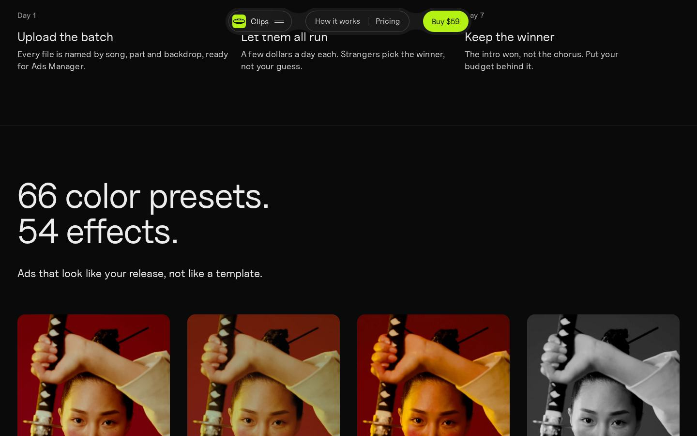

## 7. Componentes

**Barra (`header.pn`)** · fixa a 16px do topo, centralizada, 508×56px. Três segmentos: app + menu, links, comprar. Cada pílula tem 44px de altura, raio 22px e contorno interno de 1px a 20%; no hover, fundo branco a 7% e contorno a 32%. Por trás, um fundo de vidro escuro com máscara SVG que liga as pílulas como gotas (ver motion). No mobile, só o primeiro e o último segmento.

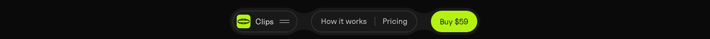

**Botão volt (`.btn`)** · 52px de altura, padding 0 20px, raio 999px, `#B4F213` com texto `#0A0A0A`, 22,5px. Hover `#C6F84A` em 200ms; `:active` `scale(.98)`; foco `outline 2px #EDEDED`, offset 3px. No hero ocupa a largura da coluna.

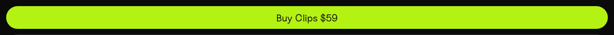

**Botão escuro (`.btn.dark`)** · igual, com `#242424` e texto `#E6E2DA`; hover `#2E2E2E`. Na seção clara vira `.btn.second`: `rgba(10,10,10,.08)` e texto `#0A0A0A`, hover a 14%.

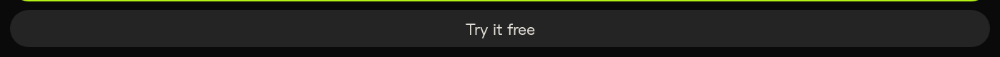

**Botão de vidro (`.ps-btn`)** · 44px, padding `0 20px 0 6px`, círculo claro de 32px com ▶, fundo `rgba(10,9,8,.5)` com blur; hover 70%. Entra com `psIn` (300ms).

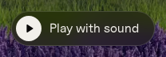

**Seletor de efeito (`.lpick`)** · miniatura 9:16 sem raio grande, nome embaixo em 18px `#A8A8A8`; hover: texto `#EDEDED` e anel duplo; selecionado (`.on`): texto claro, sem mudança no hover. Os de família (`Riso ›`) têm seta.

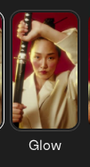

**Painel de demonstração (`.fvis`)** · `#1E1E1E`, raio 24px, padding 36px, altura 400px (340px na variante `.sm`). É o palco de cada interface falsa.

**Recorte na waveform (`.pk-sel`)** · fundo `#F2592E` a 8%, contorno interno de 1,5px a 60%, raio 14px; barras laranja, playhead volt.

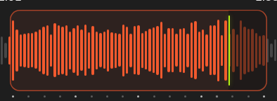

**Plano (`.tier`)** · só na seção clara: transparente, contorno interno de 1px a 14%, raio 24px, padding 54px. Preço em 40–45px, lista com ✓ e –, botão no rodapé do cartão.

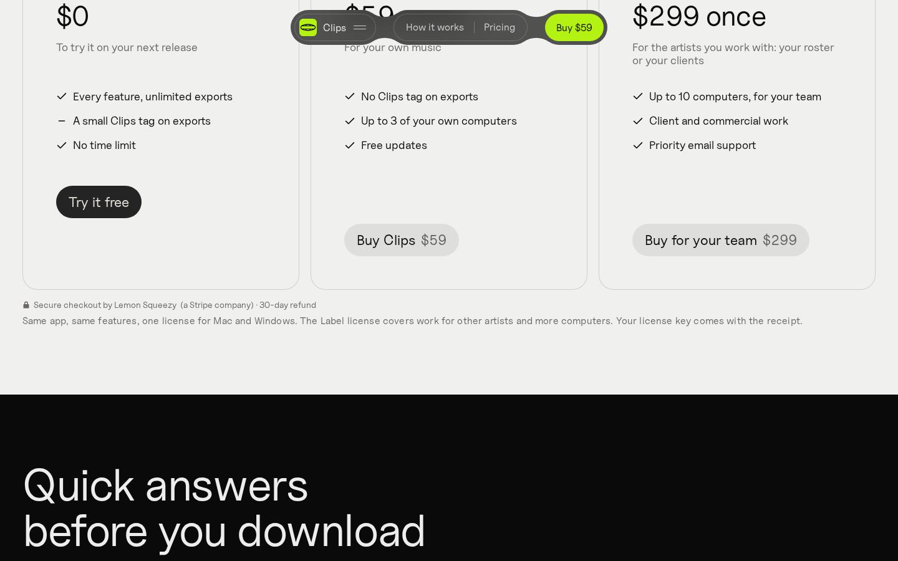

**Chip (`.chip`)** · 36px, padding 0 14px, raio 999px, borda 1px a 20%, ✓ à esquerda.

**FAQ (`.q`)** · grid 1fr 1fr, pergunta em 26px `#EDEDED`, resposta em 18px `#A8A8A8`, linha de 1px a 10% em cima, 27px de padding vertical.

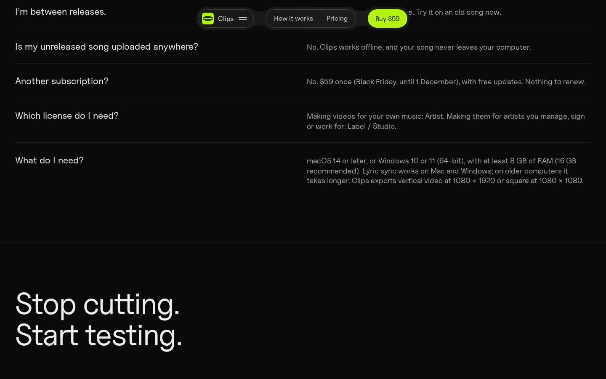

Faça: um botão volt por tela; contorno por `inset` em vez de borda. Não faça: botão volt em fundo claro (lá ele vira `.second`), sombra projetada em cartão comum.

## 8. Motion

**Princípios (interpretação).** (1) A página demonstra o produto: em vez de vídeo do app, cada seção tem a interface reconstruída em CSS e animada em loop. (2) Tudo segue a batida: 484 ms é uma batida a 124 BPM, e as durações são múltiplos dela (4 = 1,936s, 6 = 2,904s, 16 = 7,742s). (3) A interface do site em si é quase parada: transições de 150–280 ms, nada de reveal ao rolar. (4) Uma única coreografia de rolagem: o hero.

**Tokens**

| token | valor | uso |
|---|---|---|
| `duration.fast` | 150ms | cor, contorno, `:active` |
| `duration.base` | 200ms | fundo e sombra de botão |
| `duration.menu` | 220 / 260ms | menu fechar / abrir |
| `duration.modal` | 280ms | janela de download |
| `duration.beat` | 484ms | pulsos de batida |
| `ease.snap` | `cubic-bezier(.2,.8,.2,1)` | curva própria: menu, modal, barra de gráfico |
| `ease.cut` | `steps(1)` | troca de palavra, como corte de edição |
| `ease.pulse` | `ease-out` | pulsos na batida |
| `ease.scrub` | `linear` | rolagem e playheads |

**Catálogo** (cada uma com código mínimo em `tokens.json › animation` e demonstração clicável no `preview.html`)

| # | animação | gatilho | parâmetros | feito com |
|---|---|---|---|---|
| 1 | **hero-reveal**: a paisagem sobe e se alarga até a borda; a janela do app vai de 88% e de baixo para o centro | rolagem, `animation-range 0 → 90vh` | `linear`, keyframes calculados pela largura e altura da tela | `animation-timeline: scroll(root block)` + JS que escreve `@keyframes` |
| 2 | hero-safety: a cena aparece sozinha em 3s se o JS não rodar | carga | `animation: reveal 0s 3s forwards` | CSS |
| 3 | **nav-metaball**: pílulas ligadas como gotas | carga, resize | arco de raio `rf = (hd²/(R−t) − R − t)/2` | JS gera SVG → `mask` |
| 4 | menu-open | clique | opacity 160ms + transform 260ms `snap`, de `translateY(-6px) scale(.98)` | CSS transition |
| 5 | play-in | carga | 300ms `ease`, scale .9 → 1 | `@keyframes psIn` |
| 6 | **word-on-beat**: palavra por palavra no tempo | sempre | 6 batidas, `steps(1)`, atraso −n × 484ms | `@keyframes sh5w6` |
| 7 | beat-zoom: o vídeo dá um soco por batida | sempre | 484ms `ease-out`, scale 1.015, brilho 1.06 | `@keyframes beatzoom` |
| 8 | beat-dot | sempre | 484ms, scale 1.4 → 1, opacidade 1 → .5 | `@keyframes bdot` |
| 9 | karaoke-word: palavra cantada em lavanda | sempre | 2,903s `steps(1)`, +484ms por palavra | `@keyframes kl` |
| 10 | caret | sempre | 1s `steps(1)` | `@keyframes caret` |
| 11 | export-tick: barra enche, ✓ salta em escada | sempre | 10s; ✓ .4 → 1.2 → 1; +4% por item | 45 `@keyframes` gerados |
| 12 | waveform-pick: playhead em 16 batidas, brilho por batida | sempre | 7,742s `linear` + 484ms | `pkph`, `pkglow`, `pkbeat`, `pkdot` |
| 13 | winner-chart: barras crescem, vencedora acende, etiqueta salta | sempre | 8s; crescer com `snap` entre 36% e 48% | `cgrow`, `wrow`, `wpop`, `cdim`, `wshine` |
| 14 | line-draw | sempre | 8s `ease-out`, `stroke-dashoffset` 1400 → 0 | `draw`, `endin` |
| 15 | evening-clock: a noite passa em 18s | sempre | minutos 3s, horas 18s, céu em 3 camadas, 36 estrelas | `mh`, `hh`, `tk`, `sk1–3`, `star` |
| 16 | **director-demo**: cursor falso arrasta o gancho | sempre | 12s, cursor `ease-in-out` | `dmcur`, `dmhk`, `dmw`, `dml` |
| 17 | fan: cartas em leque | sempre | 6s `ease-in-out`, `--x`/`--r` por carta | `@keyframes fan` |
| 18 | slot-progress | sempre | 8s / 18s | `doing`, `sv`, `sp` |
| 19 | press | `:active` | `scale(.98)` em 150ms | transition |
| 20 | video-on-screen | rolagem | IntersectionObserver `rootMargin 400px` (carrega) e `0px` (toca) | JS |

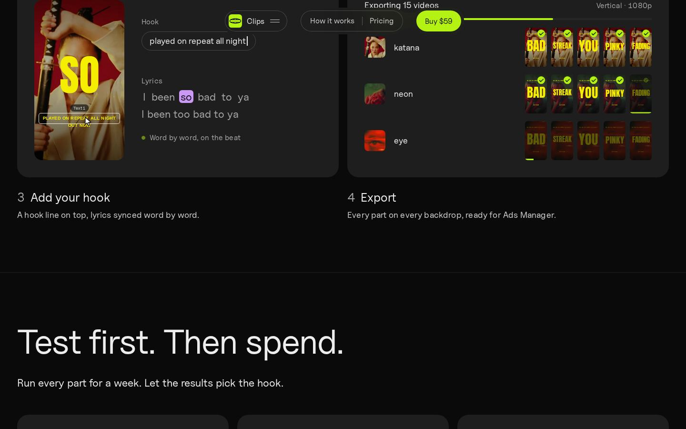

**Coreografia da página.** Carga: nada entra animado; a barra e o hero já estão lá, o botão de som surge em 300ms e o filme do hero começa 200ms depois do `load`. Rolagem: 0 → 90vh é a única cena presa (o app sai da lavanda); depois a rolagem é livre e cada seção já está tocando o próprio loop quando entra na tela.

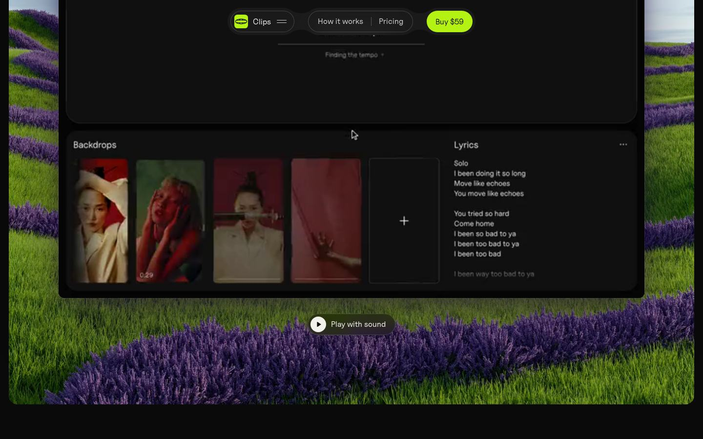

**Reduced motion.** 16 regras: as demonstrações param num quadro que ainda explica a ideia (palavras ocultas, gráfico com as perdedoras a 40%, playhead fixo em 38%), a revelação do hero não liga (a classe `pin` depende de `!reduce`) e as transições da barra são zeradas.

## 9. Stack e ferramentas

| ferramenta | versão | papel | evidência |
|---|---|---|---|
| HTML + CSS à mão | — | página e demonstrações | 882 regras em `<style>`; `tech.json` sem bibliotecas |
| CSS scroll-driven | `animation-timeline: scroll()` | hero | 4 regras; ligado só se `CSS.supports('animation-timeline','view()')` |
| JS próprio | — | monta a página a partir de `window.DC_BOARD`, calcula hero e barra, toca vídeos | script inline de 138 KB + `dc__qd88f2fef.js` (8 KB) |
| Uncut Sans | 400 | interface | `@font-face` local |
| Anton, Arimo | 400, 700 | texto dos vídeos | Google Fonts |
| Lemon Squeezy | — | checkout | texto na página |
| Cloudflare Zaraz e Turnstile | — | analytics e formulário | `/cdn-cgi/zaraz`, `challenges.cloudflare.com` |

**Não usa:** GSAP, Lenis ativo (a global existe, a rolagem é nativa), Three.js, canvas, View Transitions. Toda a riqueza de motion sai de CSS. **Peso:** 6,7 MB capturados, a maior parte em vídeo; os vídeos não carregam até chegar perto da tela.

## 10. Acessibilidade e performance

- Foco desenhado em tudo: `outline 2px` (`#EDEDED` no escuro, `#0A0A0A` no papel, `#CB98F5` na barra), offset 2–3px.
- Contraste alto: texto 16,9:1, apoio 8,3:1, botão 14,8:1.
- 61 `aria-label`, vídeos decorativos com `aria-hidden`, 6 imagens com `alt`.
- Falhas: sem skip link; títulos só em h1 e h2 (nenhum h3); 30 vídeos em loop custam bateria mesmo com o IntersectionObserver.
- `requestAnimationFrame` em repouso: 0 chamadas. Os loops são todos CSS, que roda fora da thread principal quando anima `transform` e `opacity`. Algumas animações mexem em `left`, `width` e `background` (playhead, barra de exportação), que custam layout ou pintura.

## 11. Como reconstruir

1. Tokens primeiro: `--u` e a escala de espaço em múltiplos dele; cores com nomes de papel.
2. A página parada: seções de 108px de padding, títulos de 72–88px com `text-wrap: balance`, a virada clara no preço.
3. A barra: três pílulas e depois a máscara SVG (comece com um fundo de raio 28px atrás de tudo; a máscara é o acabamento).
4. As demonstrações, uma por vez, todas a partir de uma constante de batida (`--beat: 484ms`) e durações em múltiplos dela.
5. O hero de rolagem por último, com plano B: sem `animation-timeline`, a janela aparece parada.

**Armadilhas:** keyframes do hero dependem da tela (recalcular no `resize` e depois de `document.fonts.ready`); `cqw` exige `container-type: inline-size` no clipe; 45 `@keyframes` de exportação devem sair de um gerador, não à mão; `steps(1)` com atrasos negativos é o que faz cada palavra já começar no lugar certo.

## 12. Como adaptar para outro projeto

| manter (ofício) | trocar (identidade) |
|---|---|
| Uma unidade (`--u`) para texto e espaço | Fonte e acento |
| Uma fonte num peso só, hierarquia por tamanho e cor | Uncut Sans → outra grotesca |
| Demonstrar o produto com interface falsa em CSS | O que a interface mostra |
| Um relógio único para todas as demonstrações (a batida) | O que é esse relógio no seu produto |
| Revelar o app pela rolagem a partir do hero | A cena por trás (a lavanda é deles) |
| Barra de pílulas ligadas | Cores e conteúdo das pílulas |
| Virada clara numa seção decisiva | Qual seção vira |

Exemplo aplicado: `~/projects/lyssxz/docs/design/DESIGN.md`.

## 13. Medido × lido × interpretado

- **Medido:** cores, tamanhos, espaçamentos, raios, sombras, hovers, durações e curvas que rodaram, IntersectionObservers, altura e blocos da página.
- **Lido no código:** keyframes do hero (fórmulas), máscara da barra, regras de reduced motion, carregamento dos vídeos, fontes sem uso.
- **Interpretado:** essência, personalidade, princípios de motion, nomes dos papéis de cor, o gradiente do céu (aproximado pela tela).
- **Fora da medição:** o filme do hero (só carrega ao tocar; ficou fora da captura), o menu de apps aberto, a janela de download, o banner de cookies, o arrasto do seletor de força e outras páginas do site.

## Por trás do código

- **`animation-timeline: scroll()`** liga uma animação CSS à rolagem sem JS no meio do caminho. Estude também `animation-range` e `view()`, e sempre tenha o plano B (`CSS.supports`).
- **Keyframes escritos por JS**: quando os valores dependem da tela, o JS mede uma vez e escreve um `<style>`; o navegador anima sozinho. É mais leve que mexer em `style` a cada quadro.
- **Um relógio musical**: `60 / BPM` dá a batida. Durações em múltiplos dela e atrasos negativos sincronizam dezenas de animações independentes sem nenhum JS.
- **`steps(1)`** transforma animação em corte seco: o jeito de fazer troca de palavra, contador e relógio digital em CSS.
- **Container queries (`cqw`)** deixam o texto dentro de um cartão escalar com o cartão, não com a tela.
- **Máscara SVG em data URI** (`mask: url("data:image/svg+xml,…")`) recorta um fundo de vidro em qualquer forma, mantendo o `backdrop-filter`.
- Para ir além: leia o CSS de `.lp .chart` (gráfico em 8s com 7 keyframes coordenados) e reescreva com um único `--t` e `@property`.
