# Eight Shot — design system e identidade visual

> Engenharia reversa de `https://www.cookedapps.com/eight-shot/` feita em 18/11/2026 a partir da cópia local
> (`captures/cookedapps.com_eight-shot/`). Valores **medidos** no navegador (1440×900 e 390×844) e **lidos** no código
> do site. O que é interpretação minha (nomes de papéis, personalidade, princípios) está marcado na seção 13.
> Material de estudo: logo, textos, fotos e modelo 3D pertencem à Cooked Apps.

Arquivos desta pasta: `tokens.json` (fonte), `tokens.css`, `tailwind-theme.css`, `motion.ts`, `preview.html` (abra no navegador: cores, tipos, componentes e animações clicáveis), `assets/` (imagens citadas aqui).

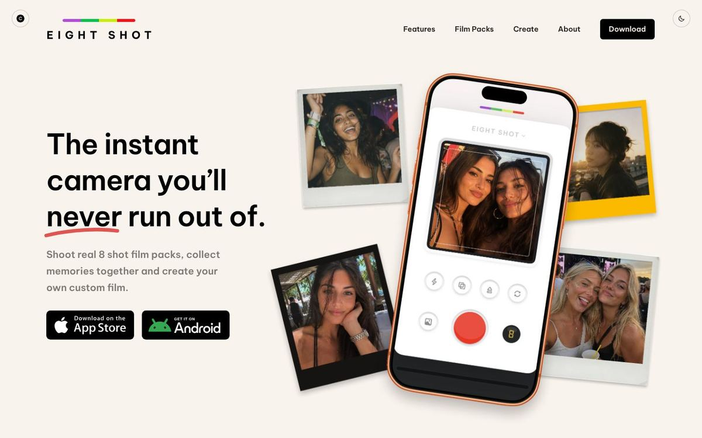

## 0. Ficha

| | |
|---|---|
| Tipo | landing de página única para um app iOS/Android de câmera instantânea |
| Stack | HTML + CSS + JS sem framework · Three.js r186 para uma cena 3D · nenhuma biblioteca de animação |
| Fonte | Be Vietnam Pro (500, 600, 700), hospedada pelo próprio site |
| Paleta | creme `#F9F3ED` · preto `#000000` · lilás `#A299BF` · vermelho de interação `#E2544F` · rótulos `#9562A8` e `#219777` |
| Forma | raios 6 / 10 / 18 / 20 / 24 px · sombras curtas de 2–3 px · sem bordas |
| Motion | uma curva padrão `cubic-bezier(.22,.61,.36,1)` · durações 140 / 240 / 620 ms · 1 entrada coreografada, 1 cena 3D presa à rolagem, reveals |
| Temas | claro e escuro (`data-theme` no `<html>`, salvo em `localStorage`) |
| Breakpoints | 1390 · 1180 · 1024 · 720 · 420 px (todos `max-width`) |
| Página | 7135 px de altura em 1440×900 (7,9 telas); 40% dela é a cena 3D |

## 1. Marca

**Essência.** Eight Shot vende limite como prazer: 8 fotos por pacote, como filme de verdade. O visual sustenta isso com
materiais de papel fotográfico (creme, sombras curtas, cantos pouco arredondados), polaroides reais como ilustração e
uma interface que quase não tem cor própria, para que as fotos carreguem a cor.

**Personalidade** (adjetivo ← evidência no site)

| | |
|---|---|
| Analógico sem nostalgia forçada | papel creme e polaroides, mas tipografia grotesca limpa e 3D em tempo real |
| Contido | uma família tipográfica, preto puro, acento em menos de 1% da área |
| Brincalhão nos detalhes | sublinhado desenhado à mão, tira de cabine inclinada, ícone que gira 18° no hover |
| Tátil | botões e selos sobem 2–3 px; cartões ganham sombra longa e o conteúdo se mexe, como objeto sobre a mesa |

**Logo.** `assets/logo.svg` (214×42 px no desktop, 178 px de largura no mobile).


- Construção: palavra `EIGHT SHOT` em caixa alta, grotesca geométrica de peso médio, com espaçamento entre letras muito aberto
  (≈ 0,45 em), e acima dela uma faixa horizontal arredondada de quatro cores: roxo `#B749E0`, verde `#00C548`, lima `#C8F000`,
  vermelho `#FF0D18`. A faixa cobre só o trecho central da palavra.
- As letras usam `currentColor`: pretas no tema claro, creme `#F5F1EA` no escuro. A faixa nunca muda de cor.
- A faixa de quatro cores reaparece dentro dos mockups do app (no topo da tela), amarrando logo e produto.
- Interação: escala 1,03 no hover e 0,99 no clique, 240 ms com curva de mola.
- Não fazer: recolorir a faixa, usar a palavra sem a faixa, apertar o espaçamento, colocar sobre foto.

**Voz e texto** (regras tiradas dos textos reais)

- Frases curtas com ponto final, em duas ou três batidas: “Fold it shut. Shoot. Open it up.”
- Números concretos no lugar de adjetivos: “just 8 shots”, “Four shots.”, “Nine frames. One memory.”
- Rótulo de seção em caixa alta com 2–4 palavras antes do título: “SHOOT LIKE REAL FILM”, “PHOTO BOOTH”, “LIMITED EDITION FILM”.
- CTA de uma palavra: “Download”. O resto são os selos oficiais das lojas.
- Inglês, segunda pessoa, tom de amigo explicando um brinquedo.
- Observação: o parágrafo do bloco de download tem dois erros de digitação no site (“Donwload Eight Shhot”). Não é estilo, é descuido.

**O que a marca não é:** fundo branco ou cinza frio; gradiente, vidro fosco ou neon; segundo tipo de letra, itálico ou
peso 800; vermelho como cor de botão ou de superfície; mais de um momento 3D por página.

## 2. Cor

| Token | Claro | Escuro | No site | Uso |
|---|---|---|---|---|
| `bg` | `#F9F3ED` | `#16141A` | `--c-page` | fundo da página; texto do botão escuro |
| `text` | `#000000` | `#F5F1EA` | `--c-ink` | títulos, texto, botão principal |
| `text-soft` | `#24231D` | `#96908A` | `--c-ink-soft` | links do menu em repouso |
| `text-muted` | `#7D7A77` | `#86838A` | `--c-ink` com `opacity: .5` | parágrafos (`.body-muted`) |
| `surface-1` | `#FCF9F7` | `#201D22` | `--c-card-film` | cartão grande e palco do 3D |
| `surface-2` | `#FCF8F6` | `#1F1C21` | `--c-card-step` | três cartões de recurso |
| `surface-3` | `#F8F5F3` | `#1E1B1F` | `--c-card-quote` | depoimentos |
| `surface-rose` | `#F3EDEF` | `#241E23` | `--c-card-booth` | painel Photo booth |
| `surface-sage` | `#F0F1EC` | `#1D211D` | `--c-card-collage` | painel Collage |
| `surface-sand` | `#F2F0EB` | `#201E1A` | `--c-card-drops` | painel Limited edition |
| `brand-lilac` | `#A299BF` | `#443C60` | `--c-cta` | só o painel de download |
| `accent` | `#E2544F` | igual | `--c-accent-red` | foco, sublinhado do menu, hover de ícone, rabisco |
| `label-plum` | `#9562A8` | igual | `--c-eyebrow-plum` | rótulos de seção |
| `label-green` | `#219777` | igual | `--c-eyebrow-green` | rótulo alternativo |
| `white` | `#FFFFFF` | igual | `--c-white` | título do CTA, cartão do QR |

Regras:
- **Seis superfícies quase iguais são de propósito.** Os cartões diferem do fundo em 1–3% de luminosidade e variam de
  temperatura (rosado, esverdeado, areia). De longe parecem papel do mesmo bloco; de perto cada seção tem seu tom.
  Não funda em um token só.
- **Proporção medida** (área da página em 1440 px): creme do fundo ≈ 62%, cartões ≈ 34%, lilás ≈ 4%, preto ≈ 0,1%, acento < 0,1%.
- O **vermelho nunca aparece parado em área grande**: é cor de estado (foco, hover, seção ativa) e do rabisco.
- O tema escuro troca 11 cores e 4 sombras; acento e rótulos ficam iguais. Os selos das lojas trocam de arte no escuro.

Contraste (medido, WCAG):

| Par | Razão | Situação |
|---|---|---|
| `text` sobre `bg` | 19,1:1 | ótimo |
| `text-soft` sobre `bg` | 14,3:1 | ótimo |
| `label-plum` sobre `bg` | 4,2:1 | abaixo de 4,5 para texto de 14 px |
| `text-muted` sobre `bg` | 3,9:1 | abaixo de 4,5: **é o corpo de texto do site** |
| `label-green` sobre `bg` | 3,3:1 | abaixo de 4,5 |
| branco sobre `brand-lilac` | 2,7:1 | abaixo de 3 mesmo para título grande |

Ao reaproveitar a estrutura: texto secundário a 62% (≈ `#5F5C5A`, 5,9:1), rótulos um passo mais escuros, e lilás
`#7F74A3` ou texto preto no painel de download.

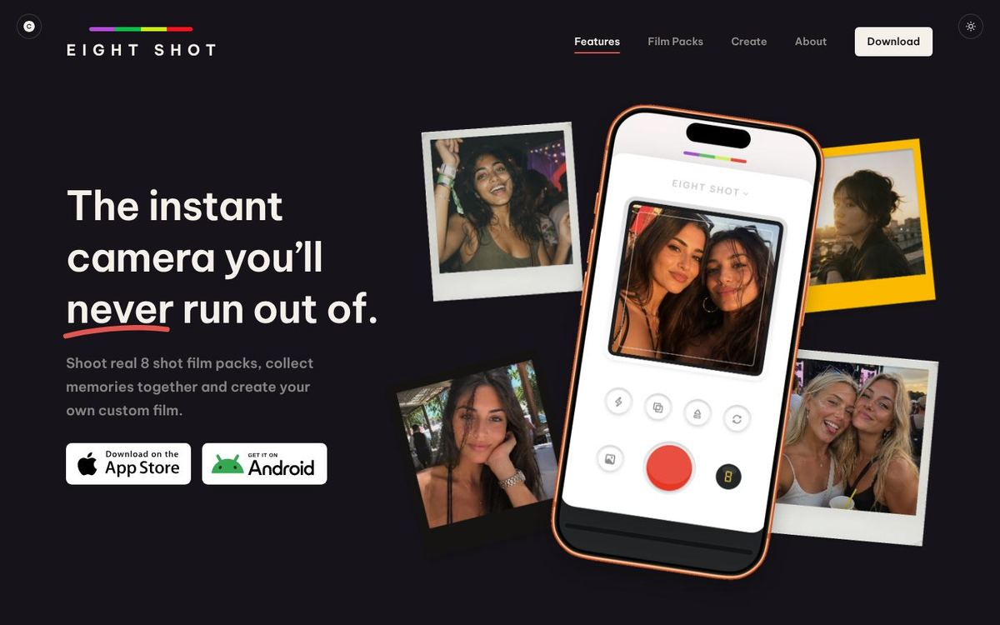

## 3. Tipografia

**Família única:** Be Vietnam Pro, grotesca humanista de formas abertas. O site hospeda os arquivos (`woff2`, subconjunto
latin, 13 KB cada) e baixa só **500, 600 e 700**. O CSS declara 300–800, mas os outros pesos nunca são pedidos.
Pilha de reserva: `-apple-system, BlinkMacSystemFont, 'Segoe UI', Roboto, Helvetica, Arial, sans-serif`.
O peso de base do `body` é **500**, não 400: é isso que dá ao texto a cor "impressa".

| Estilo | Classe no site | Tamanho (CSS do autor) | 1440 px | 390 px | Entrelinha | Peso | Tracking |
|---|---|---|---|---|---|---|---|
| `display` | `.hero__title` | `clamp(38px, 4.3vw, 58px)` · mobile `clamp(30px, 8.4vw, 42px)` | 58 | 32,8 | 1,28 | 600 | −0,018em |
| `h-section` | `.h-section` | `clamp(27px, 2.74vw, 37px)` · mobile `clamp(24px, 6.6vw, 30px)` | 37 | 25,7 | 1,16 | 600 | −0,01em |
| `h-cta` | `.h-cta` | `clamp(26px, 2.6vw, 35px)` | 35 | 26 | 1,37 | 600 | 0 |
| `h-feature` | `.h-feature` | `clamp(24px, 2.3vw, 31px)` | 31 | 24 | 1,22 | 600 | −0,01em |
| `h-card` | `.h-card` | `clamp(20px, 1.7vw, 23px)` | 23 | 20 | 1,26 | 700 | 0 |
| `quote-title` | `.quote__title` | `20px` · mobile `18px` | 20 | 18 | 26px | 700 | 0 |
| `lede` | `.hero__lede` | `20px` · mobile `16px` | 20 | 16 | 34px | 600 | 0 |
| `body` | `.body-muted`, citações, lista | `16px` · mobile `15px` | 16 | 15 | 26px (citações 24px) | 500 | 0 |
| `body-sm` | `.body-muted--sm` | `15px` | 15 | 15 | 26px | 500 | 0 |
| `nav` | `.nav__link`, `.btn` | `15px` | 15 | — | 26px | 600 | 0 |
| `eyebrow` | `.eyebrow` | `14px`, caixa alta | 14 | 14 | 1,35 | 700 | 0,02em |
| `caption` | rodapé | `12px` | 12 | 12 | 20px (links 34px) | 700 | 0 |
| `micro` | rótulo do QR | `10px` | 10 | — | normal | 600 | 0,02em |

Os valores da coluna "CSS do autor" e os tamanhos em 1440 e 390 px vieram da medição (`site_design` 0.2: regra vencedora da
cascata + estilo computado), conferidos com o `styles.css`.

Regras:
- **Escala contida.** O maior título tem 58 px; a razão título/corpo é 3,6. O impacto vem do peso 600 e do espaço em volta.
- Títulos quebram em **2–3 linhas curtas com `<br>` manual**, cada linha uma batida da frase.
- Tracking negativo só acima de 30 px; rótulos em caixa alta abrem 0,02em.
- Quanto menor o título, mais pesado: 600 até 31 px, 700 em 23 px e abaixo.
- Texto corrido nunca é preto cheio: sempre a 50% de opacidade, com entrelinha fixa de 26 px (1,62).
- Largura de linha curta: parágrafos ficam em 28–40 caracteres por linha dentro dos cartões.

## 4. Layout

- **Coluna:** `max-width: 1350px` + 20 px de margem (`.shell`); o desenho de origem tem 1440 px. O menu é mais estreito
  que a coluna (52 px de recuo de cada lado).
- **A página é uma pilha de cartões:** cada seção é um ou mais cartões arredondados sobre o creme, com **20 px** entre eles.
  Não há faixas de cor de ponta a ponta.
- **Grids:** 3 colunas com 19 px (recursos) · 2 colunas com 13 px (painéis) · 3 colunas com 38 px (depoimentos).
  Os intervalos são pequenos e irregulares porque vieram do Figma, não de uma escala.
- **Espaçamentos recorrentes:** 8 · 14 · 16 · 20 · 24 · 26 · 38 · 40 · 60 · 82 px. O 20 domina (28 usos).
- **Preenchimento de cartão:** 63/38/64 (recursos), 44/37 (painéis), 41/20 (depoimentos).

Mapa da página em 1440×900:

| Bloco | Topo | Altura | Conteúdo |
|---|---|---|---|
| `header#siteHeader` | 0 | 105 | logo, 4 links, botão Download; sticky |
| `section#top.hero` | 40 | 879 | título, texto, 2 selos, celular + 4 polaroides |
| `section#duo` | 919 | 2880 | cena 3D presa (pista de 320svh) |
| `section#film-packs` | 3819 | 1575 | cartão "8 shots" + 3 cartões de recurso |
| `section#features` | 5394 | 1152 | 2 painéis + 1 painel largo + 3 depoimentos |
| `section#download` | 6546 | 489 | painel lilás com selos e QR |
| `footer#about` | 7035 | 100 | logo, links, copyright |

Breakpoints (todos `max-width`; número de regras entre parênteses):

| | O que muda |
|---|---|
| 1390 px (22) | a coluna de 1350 vira fluida; hero passa a usar `aspect-ratio` e `vw` |
| 1180 px (11) | hero e rodapé reorganizam |
| 1024 px (20) | grids de 3 passam para 2 |
| 720 px (60) | uma coluna, texto centralizado, menu some (fica só o logo), logo 178 px, cabeçalho 67 px, pista do 3D 280svh |
| 420 px (6) | ajustes finos |

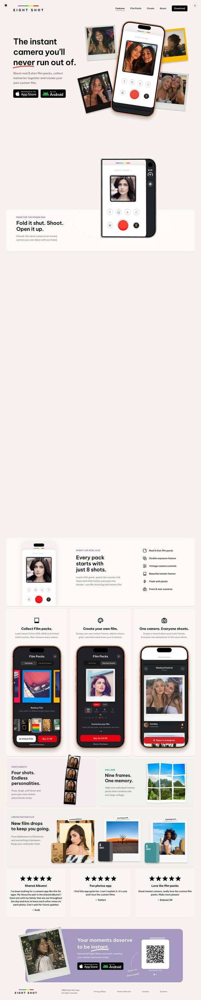

| Mobile: hero | Mobile: cartões |
|---|---|
| 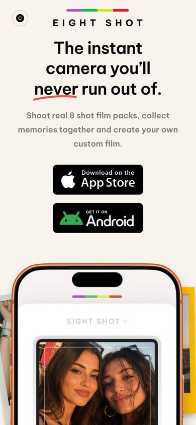 | 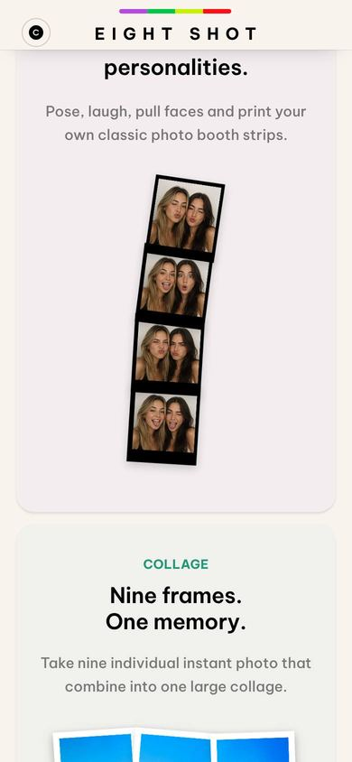 |

## 5. Forma e profundidade

- **Raios:** 6 (botão) · 10 (selos, depoimentos) · 14 (QR) · 18 (cartões) · 20 (painéis) · 24 (painel de download) · 50% (ícones).
  O raio cresce com o tamanho do objeto. Imagens não têm raio próprio: polaroides e mockups já trazem a forma.
- **Sombras em dois níveis.** Repouso: `0 3px 2px rgba(0,0,0,.10)` ou `0 2px 2px …`, uma sombra curta e dura, de papel
  encostado na mesa. Hover: soma `0 18px 34px -18px rgba(36,35,29,.34)`, longa e com espalhamento negativo, de papel levantado.
  A sombra de hover é **somada** à de repouso, não trocada.
- **Sem bordas**, exceto os dois botões-ícone (1 px, preto a 18%).
- **Efeitos:** `backdrop-filter: blur(10px)` só nos botões-ícone fixos; `drop-shadow` nos selos e polaroides (segue o
  contorno do PNG); um `radial-gradient` branco atrás do aparelho 3D; nada de `mix-blend-mode`.

## 6. Imagem e ícones

- **Mockups do app** em celular com moldura cobre, retos ou com até 4° de rotação. São a "fotografia de produto".
- **Polaroides** com retrato em close e luz quente, borda branca, amarela ou preta, sombra suave. No hero ficam espalhadas
  em volta do celular com rotações diferentes; em outras seções aparecem como tira de cabine e colagem 3×3.
- **Um modelo 3D** (celular dobrável, 19 malhas, 8 materiais) com iluminação de estúdio neutra, sem cenário.
- **Formato:** PNG com transparência para tudo que tem recorte (15 arquivos, 8,8 MB) e SVG para ícones, selos e logo
  (23 arquivos). Nenhuma imagem com `loading="lazy"`, nenhum WebP/AVIF.
- **Ícones:** traço fino 1,6 px, 16–20 px, cor do texto. Estrelas dos depoimentos preenchidas em preto.
- **Ilustração:** só o rabisco vermelho sob uma palavra do título (aparece duas vezes na página).

## 7. Componentes

**Botão** (`.btn`) — `ds-button`

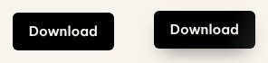

- Preto `#000`, texto creme, 15/26 px peso 600, raio 6, padding 8×18.
- Hover (medido): sobe 2 px e ganha `0 10px 22px -10px rgba(0,0,0,.55)`; um brilho diagonal atravessa em 620 ms.
- Ativo (CSS): volta e encolhe para 97,5% em 60 ms. Foco: contorno vermelho de 3 px com 3 px de afastamento.
- Há um só botão desse tipo na página (no cabeçalho). Não crie variação secundária contornada.

**Selo de loja** (`.badge-btn`)


- Arte oficial (212 px de largura), raio 10. Hover: sobe 3 px, escala 1,025 com curva de mola, `drop-shadow(0 14px 22px rgba(0,0,0,.28))`.

**Link de menu** (`.nav__link`) — `ds-nav-link`


- 15 px peso 600, cor `#24231D` → preto. Linha vermelha de 2 px que cresce da esquerda (`scaleX`), 240 ms.
- O mesmo estado marca a seção atual durante a rolagem. Clique: desce 1 px.

**Cabeçalho** (`.site-header`)

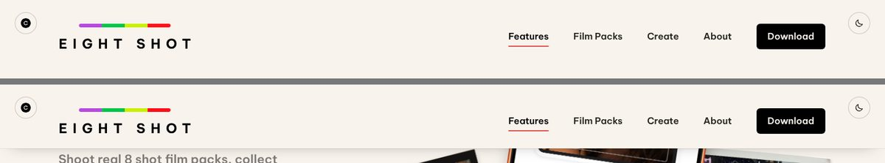

- `position: sticky`, 105 px de altura (padding 39/24). Transparente no topo; depois de 12 px de rolagem ganha fundo creme
  e sombra `0 1px 0 rgba(36,35,29,.08), 0 12px 24px -20px rgba(36,35,29,.5)`.
- Dois **botões-ícone fixos** nos cantos (36 px, círculo, fundo creme a 50% com blur, borda 1 px): casa da Cooked Apps à
  esquerda, tema à direita. Hover: borda e ícone vermelhos; o de tema gira 18°.


**Rótulo** (`.eyebrow`) — 14 px, 700, caixa alta, 0,02em, roxo ou verde. Sempre acima de um título, nunca sozinho.

**Painel** (`.panel`) — `ds-panel`

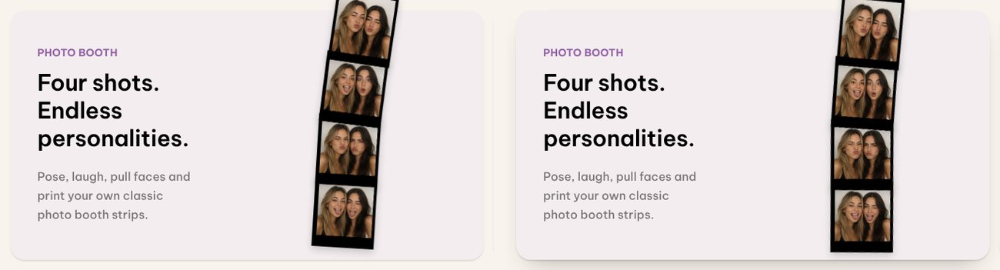

- Raio 20, sombra curta, padding 44×37, três tons de fundo. Texto à esquerda, imagem sangrando pela direita ou pelo topo.
- Hover (medido): soma a sombra longa em 240 ms e a imagem interna faz um movimento próprio em 520–560 ms
  (tira inclina −3,2° e desce 6 px; colagem cresce 4,5% e gira 1,2°).
- **O painel em si não sobe.** O CSS pede `transform: translateY(-4px)` no hover, mas `.reveal.is-in { transform: none }`
  aparece depois na folha, com a mesma especificidade, e vence. A medição confirma: só sombra e filhos mudam. Vale o
  mesmo para `.film__card` (−6 px) e `.quote`. Funciona bem assim (o cartão fica firme e o conteúdo se mexe), mas é efeito
  colateral, não decisão.

**Cartão de recurso** (`.film__card`) — raio 18, padding 63/38/64, conteúdo centralizado em coluna com 60 px entre ícone,
texto e mockup. No hover (medido): sombra longa somada, ícone salta (−3 px, escala 1,08, mola de 420 ms) e o mockup sobe 10 px em 520 ms.

**Depoimento** (`.quote`) — `ds-quote`

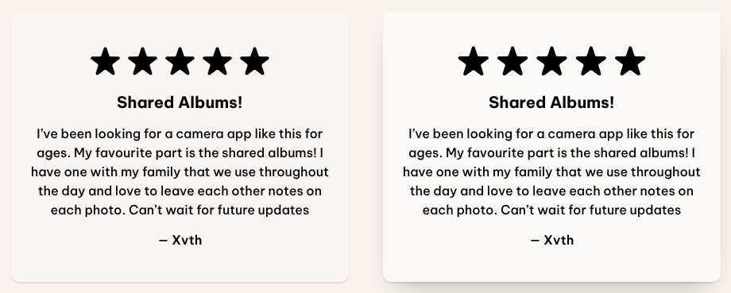

- Raio 10, padding 41×20, centralizado: estrelas, título 20/26 peso 700, texto, autor. Hover (medido): fundo clareia para `#FBF9F8`, sombra longa somada, estrelas crescem 5% com mola.

**Painel de download** (`.cta__panel`) — lilás, raio 24, 83,6% da coluna deslocado 10% para a direita, título branco com
rabisco, selos, polaroide inclinada e um cartão de QR (raio 14) com dois pontos para alternar iOS/Android.

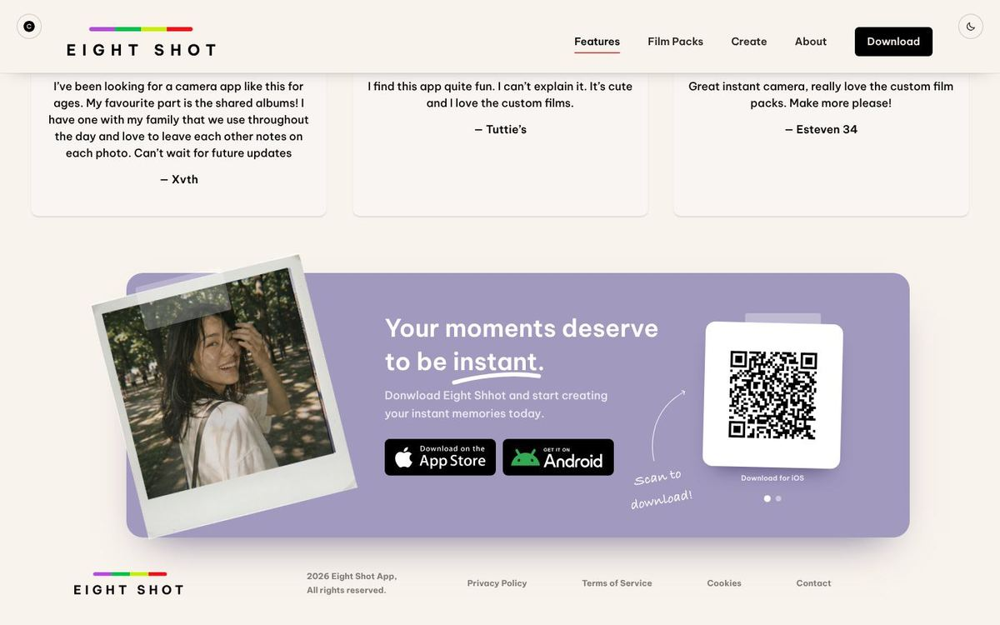

## 8. Motion

**Princípios**
1. **Três volumes.** Alto: a entrada do hero (2 s, uma vez). Médio: a cena 3D, controlada pela mão do usuário. Baixo: todo
   o resto, em 240 ou 620 ms.
2. **Uma curva para quase tudo:** `--e-out` (desaceleração suave). A mola (`--e-pop`) fica reservada a coisas pequenas
   que "saltam": ícones, selos, QR.
3. **Pai rápido, filho lento.** No hover, a sombra do cartão responde em 240 ms e o conteúdo interno em 420–560 ms.
4. **Nada sequestra a rolagem.** Rolagem nativa; a cena presa é `position: sticky`.
5. **Tudo tem versão parada:** sem JavaScript ou com movimento reduzido a página aparece inteira e estática.

**Tokens**

| Token | Valor | No site | Uso |
|---|---|---|---|
| `dur.press` | 60 ms | — | `:active` |
| `dur.fast` | 140 ms | `--t-fast` | subida do botão |
| `dur.med` | 240 ms | `--t-med` | hover, cor, cabeçalho, tema |
| `dur.pop` | 420 ms | — | ícones e QR |
| `dur.slow` | 620 ms | `--t-slow` | reveal, brilho do botão |
| `dur.draw` | 720 ms | — | rabisco |
| `dur.enter` | 980 ms | — | polaroides |
| `ease.out` | `cubic-bezier(.22,.61,.36,1)` | `--e-out` | padrão |
| `ease.soft` | `cubic-bezier(.4,0,.2,1)` | `--e-soft` | cor e fundo |
| `ease.pop` | `cubic-bezier(.34,1.4,.64,1)` | `--e-pop` | mola (passa ≈ 4% do alvo) |
| `ease.emerge` | `cubic-bezier(.16,.84,.32,1)` | `--e-emerge` | saída rápida, pouso longo |

### Coreografia da carga (linha do tempo medida)

```
0 ms      80        620      760      900      1040          1600        2020 →
│         │         │        │        │        │             │           │
          celular sobe (760 ms)──────┤
                    rabisco desenha (720 ms)────────────┤
                    polaroide 1 (980 ms)─────────────────────┤
                             polaroide 3 ─────────────────────────┤
                                      polaroide 2 ────────────────────┤
                                               polaroide 4 ───────────────┤
                                                              flutuação contínua começa em cada uma ao pousar
```

### Mapa por rolagem (1440×900)

| Posição | O que acontece |
|---|---|
| 12 px | cabeçalho ganha fundo e sombra |
| 919–3799 | aparelho 3D preso: fechado → aberto; texto ao lado troca no meio; dica "Scroll to open" some |
| ≈ 3240 | reveal do cartão "8 shots" |
| ≈ 3650 | menu marca "Film Packs" |
| ≈ 4050 | reveal dos 3 cartões de recurso |
| ≈ 4860–5270 | reveal dos painéis em escada (0 / 90 ms) e do painel largo; menu marca "Features" |
| ≈ 5670 | reveal dos depoimentos em escada |
| ≈ 6075 | reveal do painel de download; rabisco desenha 200 ms depois |

### Catálogo

Cada item tem demonstração clicável em `preview.html` e keyframes equivalentes em `tokens.css` (prefixo `ds-`).

**1. `phone-in`** · carga · CSS `@keyframes`
O celular sobe 72 px, cresce de 96% a 100% e aparece. 760 ms, atraso 80 ms, `--e-out`.
```css
.hero__phone { opacity: 0; animation: phone-in 760ms 80ms var(--e-out) forwards; }
@keyframes phone-in { from { opacity: 0; transform: translateY(72px) scale(.96) } to { opacity: 1; transform: none } }
```

**2. `shot-emerge`** · carga · CSS `@keyframes` com variáveis por elemento
Quatro polaroides saem de trás do celular e pousam. Um keyframe só serve às quatro: o ponto de partida vem de variáveis
(`--tx`, `--ty` em % do próprio tamanho, `--r0`). 980 ms, `--e-emerge`, atrasos 620 / 760 / 900 / 1040 ms.
```css
.hero__shot    { opacity: 0; animation: shot-emerge 980ms var(--e-emerge) forwards; }
.hero__shot--1 { --tx: 110.9%; --ty:  76.9%; --r0: -4deg; animation-delay:  620ms; }
.hero__shot--3 { --tx: -97.1%; --ty:  63.9%; --r0:  4deg; animation-delay:  760ms; }
.hero__shot--2 { --tx:  96.6%; --ty: -47.7%; --r0: -3deg; animation-delay:  900ms; }
.hero__shot--4 { --tx: -84.4%; --ty: -48.1%; --r0:  3deg; animation-delay: 1040ms; }
@keyframes shot-emerge {
  0%   { opacity: 1; transform: translate(var(--tx), var(--ty)) scale(.82) rotate(var(--r0)); }
  100% { opacity: 1; transform: translate(0, 0) scale(1) rotate(0deg); }
}
```
A opacidade vai de 1 a 1: a foto não surge do nada, ela já está "dentro" do celular (escondida atrás dele pelo `z-index`).

**3. `idle-float`** · contínua · Web Animations API
Ao terminar a entrada, cada polaroide flutua 7–9 px e gira menos de 1°, com períodos de 6,4 / 7,2 / 6,8 / 7,6 s para
nunca sincronizarem.
```js
shot.addEventListener('animationend', (ev) => {
  if (ev.animationName !== 'shot-emerge') return
  shot.animate(
    [{ transform: 'translateY(0) rotate(0)' }, { transform: `translateY(${d.y}px) rotate(${d.r}deg)` }, { transform: 'translateY(0) rotate(0)' }],
    { duration: d.dur, iterations: Infinity, easing: 'ease-in-out', delay: i * 240 })
})
```
O hover da polaroide usa a propriedade `scale` (separada de `transform`), então amplia sem brigar com a flutuação.

**4. `draw-underline`** · carga e rolagem · `clip-path`
O rabisco é uma imagem SVG revelada da esquerda para a direita. 720 ms, `--e-out`; atraso 620 ms no hero e 200 ms no CTA
(lá o gatilho é a classe `.is-in` do painel).
```css
.hero__underline { clip-path: inset(0 100% 0 0); animation: draw-underline 720ms 620ms var(--e-out) forwards; }
@keyframes draw-underline { to { clip-path: inset(0 0 0 0); } }
```

**5. `reveal`** · rolagem · IntersectionObserver + transição
11 elementos sobem 26 px e aparecem em 620 ms, uma vez. Escada entre irmãos por `style="--d:90ms"`.
```css
.reveal { opacity: 0; transform: translateY(26px);
  transition: opacity var(--t-slow) var(--e-out), transform var(--t-slow) var(--e-out);
  transition-delay: var(--d, 0ms); }
.reveal.is-in { opacity: 1; transform: none; }
```
```js
const io = new IntersectionObserver((entries) => entries.forEach((e) => {
  if (!e.isIntersecting) return
  e.target.classList.add('is-in'); io.unobserve(e.target)
}), { rootMargin: '0px 0px -12% 0px', threshold: 0.08 })
document.querySelectorAll('.reveal').forEach((el) => io.observe(el))
```
`-12%` embaixo: o elemento só dispara depois de subir 12% da tela, para a animação acontecer onde o olho está.

**6. `duo-fold`** · rolagem · Three.js com cena presa

| Fechado | Aberto |
|---|---|
| 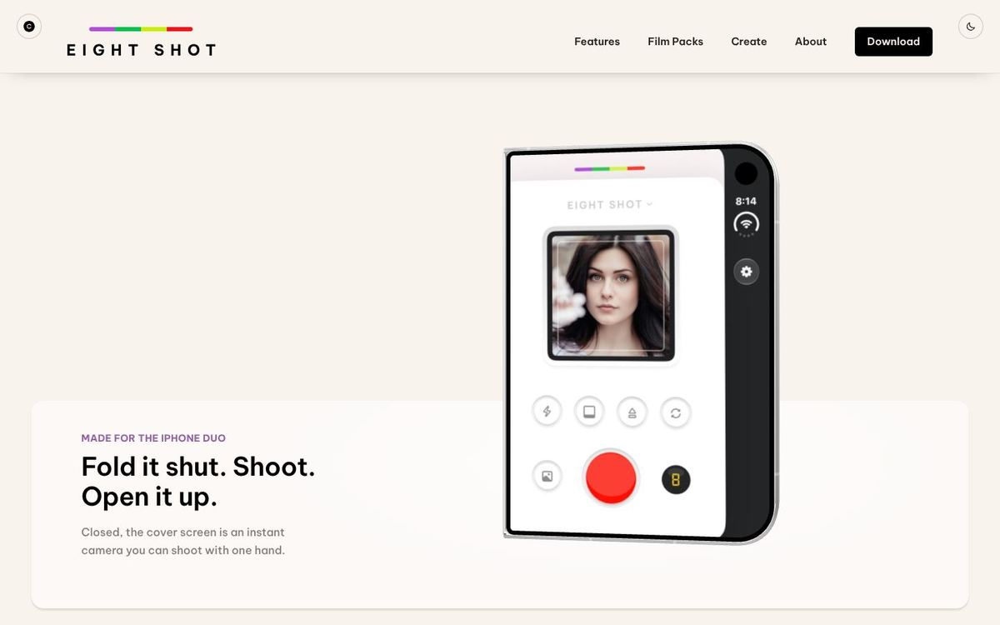 | 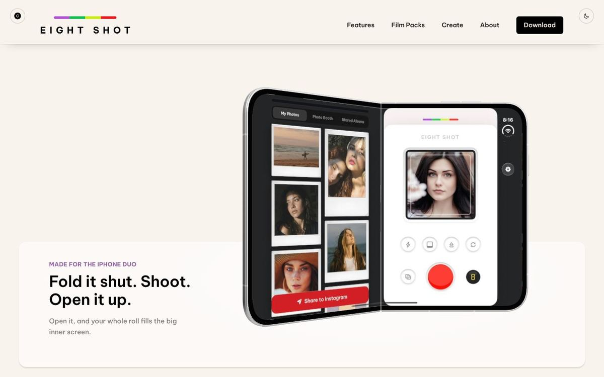 |

- **Estrutura:** `.duo__runway` com `height: 320svh` e, dentro, `.duo__stage` com `position: sticky; top: 0; height: 100svh`.
  A cena fica presa por 220svh. Não há ScrollTrigger: o "pin" é CSS.
- **Progresso:** `-runway.top / (runway.height - stage.height)`, limitado a 0–1, suavizado por quadro
  (`current += (target - current) * 0.12`) e passado por uma curva cúbica de entrada e saída.
- **O que o progresso move:** o ângulo da dobra (90° → 0°, deformando a malha da dobradiça), a rotação do conjunto em Y
  (180° → 90°, da tela externa para a interna), o recentramento do modelo e a distância da câmera, que se ajusta à largura.
- **Ponteiro:** em telas com mouse, o aparelho inclina até ≈ 0,2 rad na direção do cursor (suavização 0,08). No celular usa o
  giroscópio, limitado a ±18°.
- **Custo controlado:** `import('three')` só quando a seção chega a 600 px da tela (IntersectionObserver); o laço de render
  só roda com o bloco visível (em repouso no topo medi 1 quadro/s de `requestAnimationFrame`); o canvas aparece com
  transição de 620 ms quando o modelo carrega (`.duo.is-ready`); se o WebGL falha, `.is-failed` desfaz a pista.
- **Texto sincronizado:** dois parágrafos sobrepostos trocam por `aria-hidden` com transição de opacidade e 8 px de deslocamento.
```js
const readProgress = () => {
  const span = runway.offsetHeight - stage.offsetHeight
  return span > 0 ? Math.min(1, Math.max(0, -runway.getBoundingClientRect().top / span)) : 0
}
const ease = (t) => (t < .5 ? 4 * t * t * t : 1 - Math.pow(-2 * t + 2, 3) / 2)
function frame() {
  current += (readProgress() - current) * (reduced ? 1 : 0.12)
  const t = ease(current)
  fold((Math.PI / 2) * (1 - t))
  holder.rotation.y = Math.PI - (Math.PI / 2) * t
  renderer.render(scene, camera)
  if (running) requestAnimationFrame(frame)
}
```

**7. `header-stuck`** · rolagem · classe + transição de 240 ms (`--e-soft`) em fundo, sombra e padding.
```js
addEventListener('scroll', () => header.classList.toggle('is-stuck', scrollY > 12), { passive: true })
```

**8. `nav-underline` + scroll-spy** · hover e rolagem · `scaleX(0 → 1)` com origem à esquerda, 240 ms.
O scroll-spy usa `rootMargin: '-45% 0px -50% 0px'`: sobra uma faixa de 5% da altura no meio da tela, e a seção que a cruza
vira a ativa. Dispensa cálculo de posição.

**9. `button-lift` + brilho** · hover · sobe 2 px (140 ms), sombra (240 ms), gradiente de 220% de largura que desliza de
`130%` para `-30%` (620 ms). Ativo: `scale(.975)` em 60 ms.

**10. `card-lift`** · hover · sombra longa somada no cartão (240 ms) + filho com movimento próprio (420–560 ms). O `translateY` do cartão está no CSS mas é anulado pelo estado revelado (ver seção 7).

**11. `badge-pop`** · hover · −3 px e escala 1,025 com `--e-pop`; `drop-shadow` em 240 ms.

**12. `theme-swap`** · clique · troca de `data-theme`; `body` transiciona fundo e texto em 240 ms; botão gira 18° no hover.

**13. Detalhes** · lista de recursos: item desliza 4 px para a direita e o ícone cresce 16% girando −6° · pontos do QR: o
ativo fica em escala 1,2 · logo: escala 1,03.

**Movimento reduzido.** `@media (prefers-reduced-motion: reduce)` zera durações (`.01ms`), mostra `.reveal`, polaroides e
rabiscos já no estado final e desliga `scroll-behavior: smooth`. No JS: reveals aplicados de imediato, sem flutuação,
3D sem suavização e sem inclinação por ponteiro.

## 9. Stack e ferramentas

| Ferramenta | Versão | Papel | Evidência |
|---|---|---|---|
| HTML + CSS + JS sem framework | — | página estática única, sem build visível | `<script src>` diretos, arquivos legíveis, nenhum chunk com hash |
| Three.js | r186 | cena 3D (WebGL2) | `importmap` + `import('three')` em `duo.js` |
| GLTFLoader, RoomEnvironment, BufferGeometryUtils, SkeletonUtils | addons r186 | carregar modelo, luz de estúdio procedural, deformar a dobra | `/assets/vendor/three/` |
| glTF-Transform | 4.1.1 | otimização do `iphone-duo.glb` | `asset.generator` dentro do GLB |
| Web Animations API | nativa | flutuação das polaroides | 4 chamadas a `element.animate()` |
| IntersectionObserver | nativa | reveal, scroll-spy, ligar o 3D | 4 observadores registrados |
| CSS custom properties | nativa | 34 tokens + tema escuro | `:root` e `[data-theme="dark"]` |
| Be Vietnam Pro | woff2 próprio | tipografia | `be-vietnam-pro.css` |
| Figma | — | origem do layout | comentário no CSS: *Built from Figma "Landing page" (1440 desktop)* |
| gtag + `consent.js` | — | eventos de clique nas lojas, com consentimento | chamadas em `main.js` |

**Não usa:** GSAP, ScrollTrigger, Lenis, Motion, React/Vue/Svelte, Tailwind, Lottie, Rive, Spline. Vale registrar porque o
resultado parece "site de biblioteca" e é feito com CSS, cerca de 120 linhas de JS e um módulo de 3D.

**Organização dos arquivos**
```
index.html
assets/css/styles.css          41,7 KB · tokens, componentes, responsivo (1500 linhas comentadas)
assets/fonts/be-vietnam-pro.css + 3 woff2
assets/js/main.js               4,7 KB · tema, cabeçalho, reveal, scroll-spy, QR, flutuação
assets/js/duo.js               14,2 KB · cena 3D (módulo ES, carregado sob demanda)
assets/models/iphone-duo.glb    1,37 MB
/assets/vendor/three/           three.core.js 1,42 MB + three.module.js 0,65 MB + addons
```

**Peso** (bytes dos arquivos capturados, não o tráfego comprimido): 12,4 MB no total. PNG 8,8 MB (15 arquivos), JS 2,3 MB
(quase tudo Three.js), GLB 1,4 MB, SVG 144 KB, CSS 47 KB, fontes 39 KB.

Ferramenta de modelagem 3D e de exportação das imagens: não determinável pelos arquivos (o GLB só registra o otimizador).

## 10. Acessibilidade e performance

Bom:
- `lang="en"`, marcos `header/nav/main/footer`, um `h1`, link "Skip to content".
- Imagens: 15 com `alt`, 21 decorativas com `alt=""`, nenhuma sem atributo.
- Foco visível global: contorno vermelho de 3 px com 3 px de afastamento.
- Movimento reduzido tratado em CSS e em JS; página completa sem JavaScript (`.no-js .reveal`).
- 3D carregado sob demanda e pausado fora da tela; ouvinte de rolagem `passive`.

A melhorar (fatos medidos):
- Contraste do corpo de texto (3,9:1), dos rótulos (4,2 e 3,3:1) e do título branco no lilás (2,7:1).
- 8,8 MB de PNG sem `loading="lazy"` nem formato moderno: é o maior custo da página.
- Three.js servido em arquivos não empacotados (2 MB antes de compressão) para uma única cena.
- No mobile o menu some e não há substituto (só o logo e os dois ícones).

## 11. Como reconstruir

Ordem que funciona:
1. **Tokens primeiro:** copie o bloco `:root` (`tokens.css` desta pasta já traz tudo) e o `[data-theme="dark"]`.
2. **Página parada:** coluna de 1350, cartões com 20 px entre si, tipografia com os `clamp()` da tabela. Sem animação
   ela já precisa parecer pronta.
3. **Estados:** hover, foco e ativo de botão, link, painel. Lembre de somar a sombra de hover à de repouso.
4. **Reveal:** a classe `.reveal` + as 6 linhas do observador. Marque irmãos com `--d`.
5. **Entrada do hero:** um `@keyframes` para o celular, um para as fotos com variáveis de origem; ajuste os atrasos.
6. **Flutuação:** `element.animate()` no `animationend`.
7. **Cena presa:** pista alta + palco `sticky`. Comece com um `div` cuja largura segue o progresso, para validar a
   matemática, e só depois troque por Three.js.
8. **Movimento reduzido e sem JS** antes de dar por terminado.

Armadilhas vistas neste site:
- `transform: none` do estado revelado anula o `transform` de hover do mesmo elemento (aconteceu em `.panel`, `.film__card` e `.quote`).
  Solução: animar o hover com `translate`/`scale` separados, ou revelar num elemento-pai.
- Animar `transform` por WAAPI e por hover no mesmo elemento: use a propriedade `scale` para um deles.
- `100vh` no palco preso pula no mobile quando a barra do navegador some: o site usa `100svh` com `100vh` de reserva.

## 12. Como adaptar para outro projeto

**Manter (ofício):** pilha de cartões com tons quase iguais · sombra curta + sombra longa somada no hover · uma curva e três
durações · cartão firme com conteúdo que se mexe · entrada "o produto solta o conteúdo" · cena presa com `sticky` + progresso suavizado ·
reveal de 26 px com `rootMargin` negativo · rótulo colorido acima do título.

**Trocar (identidade):** creme e lilás · Be Vietnam Pro · polaroides e mockups · rabisco vermelho · faixa de quatro cores ·
textos. Para um ateliê de beleza, por exemplo: o "produto que solta conteúdo" vira um espelho de onde saem cartões de
serviço; a cena presa vira o antes/depois controlado pela rolagem.

Copie `tokens.json`, altere `color`, `font` e `brand`, rode `ds_build.py` e passe pelo modo ADAPT da skill.

## 13. Medido × lido × interpretado

| | |
|---|---|
| **Medido no navegador** | cores e estilos computados, tamanhos de texto em 1440 e 390 px, posições e alturas das seções, hover de 16 componentes, estado do cabeçalho, 42 animações em execução (duração, atraso, curva), 12 trocas de classe com posição de rolagem, 4 IntersectionObservers, 4 chamadas WAAPI, tema escuro |
| **Lido no código** | nomes e valores das 34 variáveis, `clamp()` dos títulos, regras `:active`/`:focus-visible`, breakpoints e o que mudam, toda a lógica da cena 3D, tratamento de movimento reduzido, metadados do GLB |
| **Interpretado por mim** | nomes dos papéis (`bg`, `surface-*`, `accent`), princípios, personalidade e regras de voz, a leitura de intenção de cada animação, as recomendações de contraste e de adaptação |
| **Fora do alcance** | larguras entre 391 e 1439 px vistas em tela, menu mobile (não existe), banner de consentimento, eventos de analytics, qualidade do 3D em GPU real (medi com renderização por software), tráfego comprimido |

## Por trás do código

- **O site inteiro é um argumento contra dependências.** O que parece ScrollTrigger é `position: sticky` + uma conta de
  progresso; o que parece biblioteca de reveal são 6 linhas de IntersectionObserver. Estude essas duas APIs antes de qualquer biblioteca.
- **Variáveis CSS dentro de `@keyframes`** (`--tx`, `--ty`, `--r0`) permitem um keyframe para N elementos com origens
  diferentes. É o truque mais reaproveitável da página.
- **`transition-delay: var(--d, 0ms)`** dá escada sem JavaScript e sem `nth-child`.
- **Propriedades de transformação individuais** (`scale`, `translate`, `rotate`) compõem com `transform`. Servem para
  somar hover a uma animação em curso.
- **Suavização por quadro** (`current += (target - current) * k`) é o "lerp" que Lenis e GSAP usam por dentro. Com
  `k = 0.12` a cena chega a 90% do alvo em ≈ 18 quadros (0,3 s a 60 fps).
- **Sombra somada** (`box-shadow: var(--base), var(--lift)`) mantém o objeto apoiado enquanto sobe: mais convincente do que trocar uma sombra pela outra.
- Para estudar a fundo: abra a cópia local (`captures/cookedapps.com_eight-shot/abrir.sh`), o `styles.css` (bem comentado
  pelo autor) e o `duo.js`; depois compare com `skills/flowdesign/references/recipes-scroll.md` (pin com sticky) e `recipes-3d.md`.
